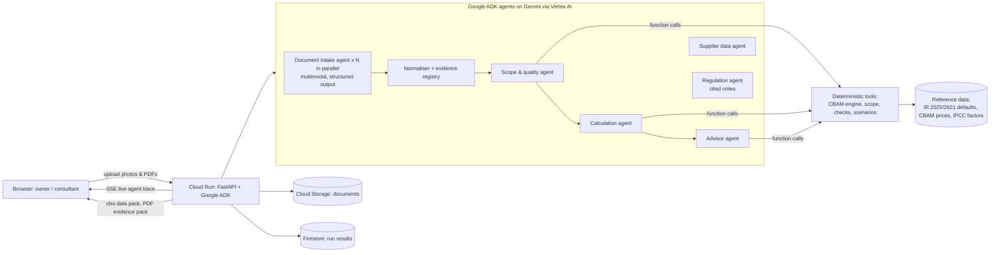

# CarbonTrail

**Paper in. Proof out.** CarbonTrail turns a small steel manufacturer's electricity bills, fuel invoices, purchase statements and handwritten production registers into EU CBAM embedded-emissions data that an accredited verifier can trace back to the source page.

Built by **Team Verdant** for the Google Cloud AI Builder Cup 2026 (JAPAC) · Track: **Manufacturing: Intelligent Operations & Industrial Efficiency**

> **Live demo:** https://carbontrail-629415533355.asia-south1.run.app · **Demo video:** `<link>` · **Deck:** `docs/CarbonTrail-deck.pdf`

---

## The problem

Since **1 January 2026**, EU importers of iron & steel, aluminium, cement and fertilisers pay for the carbon embedded in what they buy (Regulation (EU) 2023/956, definitive period). The importer can only use the exporter's own figure if the exporter supplies installation-level data calculated with the EU method (Implementing Regulation (EU) 2025/2547) and verified by an accredited verifier. Otherwise, the importer must use the EU **default value plus a mark-up** of 10% in 2026, 20% in 2027 and 30% from 2028 (IR (EU) 2025/2621).

For a fastener maker in Ludhiana, Rajkot or Bekasi, that data lives on paper: photographed LPG invoices, a mill's statement of supplies, a production register written in Hindi and English. Their EU buyers increasingly move to suppliers who can produce the numbers. Fastmarkets estimates India alone will bear about 18% of all CBAM costs.

## What CarbonTrail does

1. **Reads the paperwork.** Gemini (multimodal) reads each photo or PDF in parallel and extracts every relevant quantity with the exact quote and page it came from. It handles skewed photos, handwriting, crossed-out corrections and mixed scripts.
2. **Checks it like a verifier.** A scope & quality agent checks CBAM scope, period coverage, wire-rod balance and yield, fuel attribution, non-EU shipments and hard-to-read numbers.
3. **Calculates exactly.** A deterministic engine applies the EU method. **The language models never do arithmetic.** Every figure shows its formula, its working and links to its source evidence (`E12` → photo of the register, page 1, "May-26 62.5").
4. **Explains the money.** Your SEE vs the EU default with mark-up, gross certificate exposure in euros at the quarterly CBAM price, and ranked levers tested with what-if simulations (supplier, fuel, yield, year).
5. **Acts on the biggest gap.** About 87% of a fastener's footprint is the purchased wire rod. The supplier data agent drafts the request to the mill; when the mill's verified declaration comes back, CarbonTrail reads it and recalculates (demo: 5.36 → 3.25 tCO2e/t; on one quarter's 160 t of EU shipments, the gross CBAM cost falls from €73,865 on EU default values to €39,162, a saving of €34,703).
6. **Hands over the evidence.** An Excel data pack mirroring the sections of the Commission's Communication Template, and a PDF evidence pack with every step, quote and finding, ready for the verifier.

## Architecture



| Layer | Google Cloud |
|---|---|
| Models | **Gemini 3.8 Flash** via **Vertex AI** (global endpoint), service-account auth, no API keys. Model IDs and thinking level are environment settings (`CT_MODEL_INTAKE`, `CT_MODEL_REASON`, `CT_THINKING_LEVEL`) |
| Agents | **Google Agent Development Kit (ADK)**: `LlmAgent` with `output_schema` for intake; `SequentialAgent` of three tool-using agents for analysis; separate supplier and regulation agents |
| Hosting | **Cloud Run** (asia-south1), min 1 instance, CPU always allocated for background analysis |
| Storage | **Cloud Storage** (uploaded documents), **Firestore** (run results) |
| Build | Cloud Build from source (`gcloud run deploy --source .`) |
| Frontend | Vanilla JS, no build step. The landing page is a scroll-driven WebGL story (Three.js r169, vendored under `app/static/vendor`, MIT) with reduced-motion and no-WebGL fallbacks |

### Why the numbers can be trusted
- The engine (`app/cbam/engine.py`) implements `Em = AD × NCV × EF × OxF`, attribution to the production process, `EE = M × SEE_precursor` and `SEE = (AttrEm + EE_InpMat) / AL`.
- `tests/test_engine.py` checks the engine against a worked example computed by hand. `tests/test_pipeline.py` runs the whole agent pipeline offline with a scripted model.
- Every value in `app/cbam/data/reference.json` carries its source. Values that still need checking against the Official Journal are flagged `verify: true` (for example, the India wire-rod precursor default).
- Diesel burned in a DG set is excluded, because it is an electricity emission and only direct emissions count for iron & steel goods (Annex II). The agents explain this; the engine enforces it.

## Run it locally

```bash
pip install -r requirements.txt
# Offline (scripted model, no Google Cloud needed):
CT_DEV_SCRIPTED=1 CT_DEV_DELAY=0.15 uvicorn app.main:app --port 8080
# With Gemini on Vertex AI:
gcloud auth application-default login
GOOGLE_CLOUD_PROJECT=<project> uvicorn app.main:app --port 8080
pytest -q
```

## Deploy

```bash
python deploy/check_models.py <project>          # which Gemini IDs your project can call
PROJECT=<project> MODEL_INTAKE=<model> bash deploy/deploy.sh
```
The script enables the APIs, creates a least-privilege service account (Vertex AI user, Firestore user, Storage object admin, log writer), a bucket and a Firestore database, then deploys to Cloud Run.

## Demo data

`samples/` holds a complete, **fictional** document set for "Verkam Fasteners Pvt. Ltd.", Ludhiana, April–June 2026: three LPG invoices (two photos in kg, one e-invoice in MT), a diesel statement for the DG set, a June electricity bill, a wire-rod mill's statement of supplies, a handwritten bilingual production register with a corrected entry, and export invoices to Germany, Poland and the United Kingdom. An eleventh document is the mill's verified emissions declaration, used to show the supplier loop. `samples/make_samples.py` regenerates them. If Gemini cannot be reached during a live demo, the stored extraction for a *bundled sample* is replayed and clearly labelled "replayed" in the UI. Uploaded documents are never replayed.

## Scope and honest limits

- Beachhead: downstream iron & steel goods (screws, bolts, nuts) made from purchased wire rod: one production process, one aggregated goods category. The scope module covers all CBAM sectors at heading level.
- Euro figures use the certificate price of the quarter the goods are imported in (the demo's April–June shipments: Q2 2026, €75.28/t). Gross cost is shown first; the estimated payable amount after the free-allocation adjustment (97.5% × the default benchmark of 1.364 tCO2e/t for fasteners) is shown next to it. With verified actual data the producer calculates its own adjustment, so that figure is an estimate. The adjustment applies to both cases, so it does not change the saving.
- Every agent call fails over to a backup Gemini model if the primary is overloaded (429) or slow; the regulation chat falls back to quoting the matching curated notes, and the supplier email to a template, so a demo never hangs.
- Uploaded documents are deleted from Cloud Storage by a one-day lifecycle rule; Firestore keeps only summary figures and file names.
- CarbonTrail prepares verification-ready data. It does not replace the accredited verifier or the EU declarant.

## Roadmap
UK CBAM (from 1 January 2027) output from the same data, India CCTS reconciliation, country packs (grid factors, languages) for Viet Nam, Indonesia, Thailand and Malaysia, direct export of the official Communication Template, and a WhatsApp intake channel for factory owners.

## Sources
Regulation (EU) 2023/956 and 2025/2083; Implementing Regulations (EU) 2025/2547, 2025/2620, 2025/2621 and 2026/1740; Commission CBAM Guidance Nos. 2 and 3 (14 August 2026); quarterly CBAM certificate prices (Q1–Q3 2026); IPCC 2006 Guidelines Vol. 2. Full list with links in `app/cbam/data/knowledge.md`.

---
Team Verdant: Preetham Kukkadapu, Harshitha Neelam
